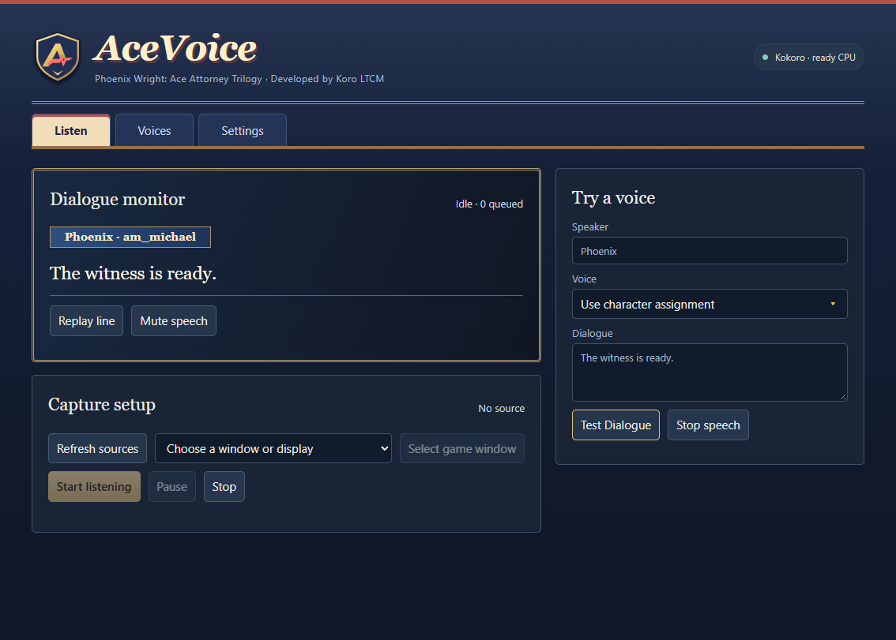

# AceVoice


Developed by **Koro LTCM** for the **English Windows edition of Phoenix Wright: Ace Attorney Trilogy**. AceVoice reads the dialogue box and nameplate visible in the game window and adds character-specific speech while you play. Its courtroom badge, brass-trimmed dialogue panel and case-file tabs are original companion graphics. The game supplies its own visuals and soundtrack.

Double-click **release\AceVoice-0.3.3\AceVoice.exe** in a built Windows copy. Keep its folder together. The portable build includes Electron, Python, the English OCR worker and its language data. First launch downloads about 354 MB of Kokoro assets to the current Windows account. Later launches work offline.



## Personal voices and casting tools

Open **Voices → Personal voices**, name your voice, then choose an audio file or record your microphone. Use 3–30 seconds of clean English speech from one person whose voice you have permission to use. Click **Import voice**, then **Preview imported voice** to hear a newly generated sentence. In the cast register choose a character or Narrator, open **Assigned voice**, type the name you gave your recording, press **Enter**, then **Save voice**. Personal voices use a separate local Pocket TTS engine. Its English model downloads on the first import; recordings remain local. Kokoro continues to handle stock and blended voices.

**Settings → Pronunciation dictionary** changes speech while preserving the displayed dialogue. **Cast presets** exports or merges character assignments as JSON. Personal audio is excluded. To restore a preset referencing a personal voice on another PC, import the same reference clip with the same name first. While AceVoice is open use **Ctrl+Alt+P** to pause/resume listening, **Ctrl+Alt+M** to mute/unmute, and **Ctrl+Alt+R** to replay. Settings shows shortcut conflicts.

## First session

1. Open **Listen**. When the engine badge says **ready**, click **Test Dialogue** to try Phoenix with the game closed.
2. Open the game in windowed or borderless mode. Click **Refresh sources**, select its title, then **Select game window**. Use a display if window capture is black.
3. Leave **Dialogue detection** on **Automatic**. AceVoice looks for the dialogue panel and blue speaker nameplate as you play. **Test recognition** previews the current words.
4. Click **Start listening** and return to the game. Dark transitions keep listening active. Readable lines with moderate OCR confidence get extra time to settle. **Pause** suspends recognition and stops speech. **Stop** releases the capture. Navigating to another AceVoice tab keeps listening active.
5. In **Voices**, select a character and use **Preview voice** to hear edits before saving. Settings controls interruption, OCR sensitivity, volume and the 256 MiB WAV cache.

The cast register includes 21 suggested roles. With the pinned English pack, Kokoro offers 28 stock voices and 218 equal-weight same-dialect pairs. Blends share underlying voices and can sound similar. Pearl and Cody have brighter, faster presets. The Judge and Grossberg have slower presets. The age and character fit are editorial suggestions for audition. Unrecognized names draw from a mixed pool without age or gender inference. Unnamed story dialogue gets a random English stock voice for each mystery exchange. Green date/time/location cards and episode prompts use the editable Narrator, Isabella at 0.94× by default. Replay and the last 40 lines are available on Listen. The player advances the game normally.

## Windows developer setup

Use x64 Node 24 and Python 3.11. From this folder in PowerShell:

```powershell
npm.cmd ci
npm.cmd run setup:electron
py -3.11 -m venv services/tts/.venv
.\services\tts\.venv\Scripts\python.exe -m pip install -r services/tts/requirements-windows.lock
npm.cmd run dev
```

If Python came from uv and the launcher cannot find it, substitute the installed interpreter in the venv command, for example:

```powershell
& "$env:APPDATA\uv\python\cpython-3.11.17-windows-x86_64-none\python.exe" -m venv services/tts/.venv
```

## Verify or package

```powershell
npm.cmd run lint
npm.cmd test
npm.cmd run build
$env:ACEVOICE_REAL_TEST='1'
.\services\tts\.venv\Scripts\python.exe -m pytest services/tts
npm.cmd run smoke
powershell -NoProfile -ExecutionPolicy Bypass -File scripts/package-windows.ps1
```

The packaging command sets execution policy only for its child shell. Developer setup and launch above need no script-policy change. Build with a clean x64 CPython 3.11 virtual environment. Move an existing release folder aside before rebuilding. The output is an unsigned portable folder. To exercise that copy directly, set `$env:ACEVOICE_SMOKE_EXE=(Resolve-Path release/AceVoice-0.3.3/AceVoice.exe).Path` before `npm.cmd run smoke`. The smoke test uses a temporary profile, port 18766, and a dedicated synthetic window.

See [Windows troubleshooting](docs/WINDOWS_SETUP.md), [calibration](docs/OCR_CALIBRATION.md), [architecture](docs/ARCHITECTURE.md), and the [future bridge plan](docs/GAME_BRIDGE_PLAN.md).


